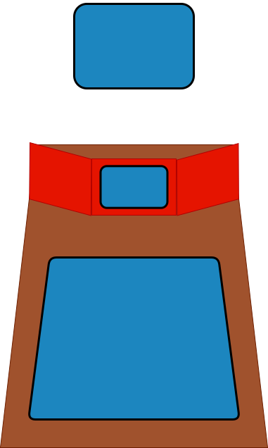

# Mechanus (WIP)

[](https://github.com/DaanV2/mechanus/actions/workflows/checks.yaml)

This project provides software for a local vttrpg / gaming setup, by managing multiple screens/clients/players/dm to help create a ttrpg experience using hardware, allowing a virtual table screen, scenery screens etc.

This project uses server driven UI, where the server written in [Go](https://go.dev/), The screen (or client) side is using [Pixi.js](https://pixijs.com/) for the rendering of the screens. While [connectRpc](https://connectrpc.com/) pins down the protocol between server and client. Each screen or client can connect and either login in as a viewer, device, player, or GM and either get their own screen rendered.

Everything is driven by **scenes**: a scene knows which players, NPCs and enemies are present, can have variants (night, rain, combat, ...), and tells every device in the room what to do. The table TV shows the battle map, other screens show scenery or information boards, smart lights (Hue, Matter, Home Assistant) set the mood, music (Spotify, iTunes) plays the right track, and custom devices receive events over MQTT or similar. The goal is to control the entire game room from the browser. See [Scenes & Outputs](./docs/architecture/scenes.md).



## Quick Start

For local development with Docker:

```bash
docker compose watch
```

This will build and start the application with automatic rebuilds on code changes. See [Local development](./docs/development.md) for more details.

## Contents

- [Documentation](./docs/README.md)
- [Roadmap](./docs/roadmap.md)
- [Local development?](./docs/development.md)
- [Want to contribute?](./docs/contributing.md)

## Tech Stack

Go server + SvelteKit/Pixi.js client, connected via ConnectRPC (gRPC) and WebSocket. See [docs/architecture](./docs/architecture/README.md) for a full breakdown of the server layers, client structure, and communication protocols.

