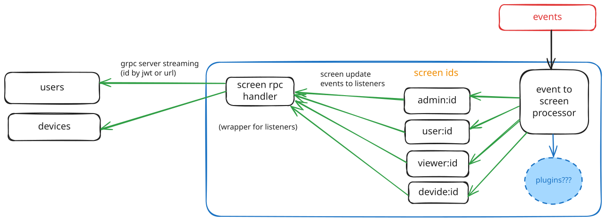

# Scene to Screen

This document describes how scenes are mapped to screens in the Mechanus server (which are eventually sent to listening clients).

The scene model — scenes, variants, targets, rooms, and how a scene instructs screens and other devices — is described in [architecture/scenes.md](../../../docs/architecture/scenes.md). In short: a scene's `ScreenInstruction` for a target is sent to every screen device bound to that target, and the `screen` integration driver turns it into screen state broadcast over the screen WebSocket.

Listening clients can be any users logged in with the role of `admin`, `operator`, `user` or `viewer`, or devices; optionally they can request to listen to specific screens.

## Flow

